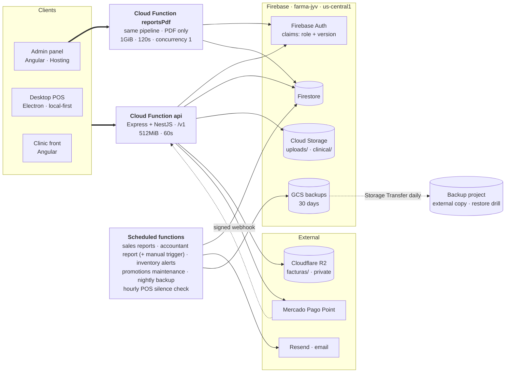
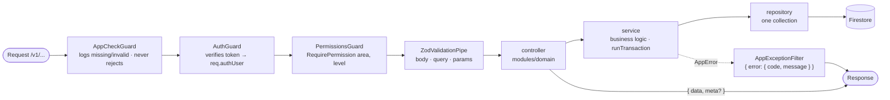

# CLAUDE.md

This file provides guidance to Claude Code (claude.ai/code) when working with code in this repository.

## Overview

FarmaJyV backend: a pharmacy management REST API built with **NestJS**, running as a single Firebase Cloud Function (`api`, region `us-central1`) that mounts the Nest app on an Express instance. Firestore is the database, Firebase Auth issues tokens, and Cloud Storage holds uploaded invoice files. Firebase project id is `farma-jyv`. All code lives in [functions/](functions/); the repo root only holds Firebase config.

Note: user-facing strings and error messages are in Spanish. Match that when adding new ones.

See [GOALS.md](GOALS.md) for the product/functional goals (includes the NestJS migration plan/history) and [MEMORY.md](MEMORY.md) for a persistent fact sheet (collections, endpoints, env vars, known pending work) — keep both updated when architecture or scope shifts.

## Architecture diagram

Deployment view. Everything server-side is one Firebase project (`farma-jyv`,
`us-central1`): a single Cloud Function serves the whole API (PDF downloads, which
launch Chromium, go to a sibling `reportsPdf` function — SPEC 38), and the scheduled
functions run beside it. Diagram renders on GitHub; keep it in sync when a
service, scheduled job or external dependency is added or removed.



Two things the picture is meant to make obvious:

- **One function, one database.** There is no service mesh and no read replica:
  every client hits the same `api`, and every report reads the same Firestore.
  That is why cold start and read volume are cost decisions, not details — see
  [Cost and cold start](#cost-and-cold-start).
- **Invoice files are the only split storage.** Prefix `facturas/` goes to
  Cloudflare R2, anything else to Firebase Storage; `isR2Path()` is the single
  switch. Clinical attachments never move (patient data, NOM-004).

## Commands

All commands run from [functions/](functions/):

```bash
npm run build          # tsc -> lib/
npm run build:watch    # tsc --watch
npm run lint           # ESLint (flat config disabled; uses .eslintrc.js; parserOptions.project -> tsconfig.eslint.json so it covers test/ too)
npm run dev            # build + run lib/dev-server.js (Nest app on PORT, default 3000)
npm run serve          # alias of `emulators`
npm run emulators      # env-split check + build + emulators (auth/firestore/storage/functions, UI :4000), project demo-farmajyv, data persisted in ../.emulator-data
npm run seed:emulator  # dummy roles/users/catalog/patient into the running emulators (refuses non-demo projects)
npm run deploy:dev     # env-split check + deploy to farma-jyv-dev (--project dev)
npm run deploy:prod    # deploy to farma-jyv (--project prod); `deploy` is an alias
npm run test           # firebase emulators:exec --only firestore "jest" - integration tests against the Firestore emulator
npm run deploy         # alias of deploy:prod (build + deploy functions, firestore rules/indexes, storage rules)
npm run migrate:roles  # build + run lib/scripts/migrate-roles.js
npm run backfill:denormalized          # backfill totalStock / productIds / batches.supplierId
npm run backfill:denormalized -- --dry-run --only=products,batches   # idempotent; --force recomputes
npm run logs           # firebase functions:log
npm run pitr:restore -- --project farma-jyv --read-time <ISO con zona> --doc col/id   # en seco; --execute reescribe
```

Operational infrastructure (SPEC 31/32/34/42/43: PITR, external backup copy, alert policies, budget, cold-start query, instances dashboard, restore drill) is declared in [scripts/ops/](scripts/ops/) and applied by hand: every script is **dry-run by default** and needs `--apply` to touch GCP. `npm run test:ops` (repo root, also in CI) validates the templates in `scripts/ops/defs/` and that no script calls `gcloud` without `--apply`. Procedures live in RUNBOOK §4 and §7–§9.

### Security-rules tests (run from the repo root, not from `functions/`)

```bash
npm run test:rules     # firebase emulators:exec --only firestore --project farma-jyv-rules "npm --prefix functions run test:rules"
```

Specs live in [functions/test-rules/](functions/test-rules/) (`@firebase/rules-unit-testing` + the client SDK, config in `functions/jest.rules.config.js`). They are deliberately **not** part of `npm run test`: that script runs `emulators:exec` from `functions/`, where the root `firebase.json` is not visible, so the emulator boots with wide-open rules and any rules assertion would pass vacuously. The specs also load `firestore.rules` explicitly through `initializeTestEnvironment({ firestore: { rules } })`, so they enforce the real file regardless of what the emulator was started with. To sanity-check the harness, temporarily flip one `assertFails` to `assertSucceeds` — it must go red with an `evaluation error at L<n>` pointing into `firestore.rules`.

Emulator ports: functions 5001, firestore 8080, auth 9099. Tests live in [functions/test/](functions/test/) (Jest + `ts-jest`, config in `jest.config.js`); they run against the real Firestore emulator via `firebase-admin`, not a mock. Coverage is targeted, not uniform: the highest-risk Firestore transactions (inventory entry/exit in `inventory.service.ts`, FEFO sale allocation in `sales.service.ts`) and everything that decides **access** (`auth.guard.ts`, `roles.service.ts`, `users.service.ts`) have tests, because a hole there is a privilege escalation rather than a wrong number. Trivial CRUD (categories, suppliers, doctor, uploads) has none — add tests when touching transactional, money- or access-critical code, not for parity's sake elsewhere.

**Jest runs with `TZ=UTC`** (set at the top of `jest.config.js`), the same as Cloud Functions and the CI runner. On a developer machine in `America/Mexico_City` any code that builds a `Date` from a bare string (`new Date('2026-08-07T00:00:00')`) or reads `getDate()`/`toISOString().slice(0, 10)` silently works, then breaks in production between 18:00 and 24:00 local. Day boundaries, printed times and age go through `utils/timezone.ts` (`APP_TIME_ZONE`, `getZonedYmd`, `resolveRangeBoundary`, `formatLocalDateTime`); [test/timezone-day-boundary.spec.ts](functions/test/timezone-day-boundary.spec.ts) pins a 19:00 Mexico instant.

`maxWorkers: 1` is not a performance oversight: the suites share one Firestore emulator and in parallel they fight over transaction locks (`ABORTED: Transaction lock timeout`). **[test/teardown-admin.ts](functions/test/teardown-admin.ts) wipes the database before each spec file** through the emulator's `DELETE /emulator/v1/projects/<id>/databases/(default)/documents`, so every suite starts empty. That is not tidiness: the emulator locks *pessimistically* (production Firestore is optimistic), so on a loaded database two transactions touching the same document serialise until the SDK's five attempts run out and surface `ABORTED: Transaction lock timeout` — which is exactly what made the sale-concurrency spec fail about one run in four. Clearing before rather than after leaves a failing suite's documents in place for inspection. Never make a spec depend on data another spec wrote.

`npm run test:coverage` enforces `coverageThreshold` from `jest.config.js`. With the suites isolated the figure is reproducible run to run (±0.02), so the global floor sits just under the measured value instead of the two points of slack it needed while suites shared state. Per-file gates are strict where it matters (`auth.guard.ts` and `memory-cache.ts` at 100% lines, `users.service.ts` at 80%). `src/scripts/**` is excluded: one-off operational scripts run by hand with someone watching the output.

### CI

`.github/workflows/ci.yml` runs on push to `main`, on pull requests and as a reusable workflow (`workflow_call`): `npm ci` → `npm run lint` → `npm run build` → `npm run test:coverage` → **`Pruebas de reglas`** (`npm run test:rules` with `working-directory: .`, i.e. from the repo root — SPEC 33; from `functions/` the rules would pass vacuously), with Temurin JDK 21 installed because the Firestore emulator needs a JVM, and the coverage report uploaded as an artifact for 14 days.

`.github/workflows/deploy.yml` (SPEC 39) deploys: CI green on a `main` push → `farma-jyv-dev`; tag `v*` on `main` → re-runs `ci.yml`, lists PRs labelled `requiere-paso-manual` in the run summary, then waits for `dev-jyv` to approve the `production` environment before deploying `farma-jyv`. Both jobs deploy `firestore:indexes` first and wait for none to be `CREATING` (`scripts/ci/wait-firestore-indexes.sh`) before `functions,firestore:rules,storage`. Auth is Workload Identity Federation (`vars.GCP_WORKLOAD_IDENTITY_PROVIDER` / `vars.GCP_DEPLOY_SERVICE_ACCOUNT` per environment, set up by `scripts/ci/setup-wif.sh`) — never a JSON key. `functions/.env.<project>` is written in the job from the environment variable `FUNCTIONS_ENV_FILE` by `scripts/ci/write-functions-env.mjs`, which refuses any of the SPEC 35 credentials and refuses to run until they are all declared with `defineSecret`. Before deploying functions it runs `functions/scripts/check-secrets.mjs` (SPEC 35) so a missing secret stops the job by name; the deploy account cannot grant `secretAccessor`, so a new secret needs that binding first (RUNBOOK §10.1). It never runs backfills or `migrate:roles`. `simulacro-restauracion.yml` opens the monthly restore-drill issue (SPEC 43). Release procedure: RUNBOOK §10.

## Request lifecycle

Every request flows through the same layered path — respect these boundaries when adding features:

```
modules/<domain>/*.controller.ts  ->  Guards (AppCheckGuard, AuthGuard, PermissionsGuard) + ZodValidationPipe
  ->  services/*.service.ts  (business logic, Firestore transactions)
    ->  repositories/*.repository.ts  (raw Firestore reads/writes for one collection)
```



- **Controllers** ([functions/src/modules/](functions/src/modules/)) are thin Nest `@Controller()` classes, one folder per domain (`identity`, `catalog`, `inventory`, `sales`, `uploads`, `doctor`, `internal`, `health`). Each handler calls a `@RequirePermission(area, level?)` decorator (default level `write`), validates `@Body()/@Query()/@Param()` with `new ZodValidationPipe(schema)` (schemas from [schemas/index.ts](functions/src/schemas/index.ts), unchanged from before the Nest migration), and returns a plain `{ data, meta? }` object — there is no global response-envelope interceptor, controllers build the envelope themselves to match each endpoint's original shape exactly.
- **Services** hold all business logic and orchestrate multiple repositories, exactly as before the Nest migration — they are still plain exported functions (not `@Injectable` classes), imported directly by controllers. This was a deliberate choice made during the migration: converting them to DI-managed providers would have added risk/ceremony with no benefit, since nothing needs them injected across module boundaries. **Re-measured 2026-08-03 and confirmed closed:** no import cycles among services, 5 cross-service edges all one-directional and one layer deep (`auth→roles`, `users→roles`, `inventory→products` for inline product creation only, `sales→mercado-pago`, `sales-report-sender→email`/`report-pdf`), one service per controller (two in `users`/`internal`). Do not convert to `@Injectable` — reopen only if an import cycle appears or a test needs to substitute a service. Cross-collection writes (sales, inventory entries/exits) MUST use `firestore.runTransaction` — **all reads in a transaction must happen before any writes** (Firestore requirement); see `sales.service.ts`'s `createSale` for the pattern when a transaction touches N documents read in a loop. Services throw `AppError`s from [utils/errors.ts](functions/src/utils/errors.ts) (`notFound`, `badRequest`, `forbidden`, `unauthorized`, `conflict`) — never raw errors for expected failures.
- **Repositories** are the only place that touches Firestore collections directly. One file per collection; they return domain types from [types/index.ts](functions/src/types/index.ts) and stamp `createdAt`/`updatedAt` via `now()`. `products.repository.ts`'s `createProduct`/`updateProduct` run the sku/name/barcode uniqueness check *inside* the same `runTransaction` as the write, to close a create/update race — follow that pattern for any other uniqueness constraint.

Responses use the envelope `{ data, meta? }`. Errors are converted to `{ error: { code, message } }` by the global `AppExceptionFilter` ([common/app-exception.filter.ts](functions/src/common/app-exception.filter.ts)) — it special-cases `AppError` (from `utils/errors.ts`) and Nest's own `HttpException` (e.g. its built-in 404 for unmatched routes), falling back to 500 `INTERNAL_ERROR` for anything else.

**Sync error codes (SPEC 49).** The POS decides retry / block / reconcile by a stable business code, never by message text. The catalog is [constants/sync-error-codes.ts](functions/src/constants/sync-error-codes.ts) (`SYNC_ERROR_CODES`, copied verbatim into the POS `shared/models` — a different list in each repo is a bug; `test/sync-error-codes.spec.ts` pins it). `AppError` takes an optional `{ syncCode, retryable }` (the helpers take `syncCode` as their last argument); `retryable` defaults from the code (`DEFERRED`, `ENTRY_IN_PROGRESS`, `INTERNAL`) or, without one, `status >= 500`. The filter adds `error.details: { code, retryable }` **next to** the unchanged `{ code, message }` when the error has a `syncCode`, and `{ code: 'INTERNAL', retryable: true }` for anything ≥ 500 or unexpected. `createSale`, `voidSale` and `createStockEntry` are thin wrappers that tag every untagged 4xx as `VALIDATION` (`withDefaultSyncCode`), so the rejections the POS routes differently carry their own code from where they are thrown (`STOCK_INSUFFICIENT`, `BATCH_EXPIRED`, `PRODUCT_NOT_FOUND` vs `PRODUCT_INACTIVE` — same message, split check —, `SESSION_CLOSED`, `SESSION_FORBIDDEN` in `assertCanAccessSession`, `IDEMPOTENCY_CONFLICT`, `ALREADY_VOIDED`, `HAS_RETURNS`, `VOID_FORBIDDEN`, `ENTRY_IN_PROGRESS` for a recent reservation or a lost reservation race — 409, retryable —, `ENTRY_AMBIGUOUS`). `/sales/bulk` per-index failures are `{ ok: false, code, error, retryable }` via `describeSyncError` (non-`AppError` or ≥ 500 → `INTERNAL` retryable, and logged — the batch swallows it). `ZodValidationPipe` rejections are `VALIDATION`. Visible messages did not change: old POS builds still classify by text.

Get Firestore via `db()` and timestamps via `now()` / `toTimestamp()` from [utils/firestore.ts](functions/src/utils/firestore.ts) — do not call `getFirestore()` directly. `db()` also lazily applies `ignoreUndefinedProperties: true` on first call — omitted optional fields (`barcode`, `costPrice`, etc.) are common across services and the Admin SDK rejects `undefined` values by default; do not reintroduce manual `undefined`-stripping in individual services, the global setting already covers it. `admin.initializeApp()` happens once in [index.ts](functions/src/index.ts) / [dev-server.ts](functions/src/dev-server.ts), **before** the Nest app bootstraps (Nest providers assume the default app already exists).

## App bootstrap

[app.ts](functions/src/app.ts) builds a single Express instance, applies `corsMiddleware` and a conditional JSON body-parser (skipped for `multipart/form-data`, since uploads are parsed by a custom Busboy-based interceptor — see below), then hands that Express instance to `NestFactory.create(AppModule, new ExpressAdapter(expressApp), { bodyParser: false })` and calls `setGlobalPrefix('v1')`. The resulting app is cached at module scope (`cachedApp`) so warm Cloud Function invocations don't re-pay Nest's DI bootstrap cost, and the JSON parser is built once rather than per request. [index.ts](functions/src/index.ts) awaits this once and reuses it across `onRequest` invocations — **caching the promise but not its rejection**: a failed bootstrap clears the cache so the next request retries, instead of that instance answering the same error until Cloud Run recycles it; [dev-server.ts](functions/src/dev-server.ts) does the same for local dev.

[app.module.ts](functions/src/app.module.ts) is the root Nest module: through `GLOBAL_HTTP_PROVIDERS` ([common/http-pipeline.ts](functions/src/common/http-pipeline.ts), shared with `reportsPdf`) it registers `AppCheckGuard`, `AuthGuard` and `PermissionsGuard` as global `APP_GUARD`s (in that order — App Check only logs and never rejects; auth must resolve `req.authUser` before permissions can be checked) and `AppExceptionFilter` as the global `APP_FILTER`, then imports `CommonModule` (global, exports `FirestoreService`) plus every domain module.

**Two Nest apps, one HTTP pipeline (SPEC 38).** CORS, the conditional JSON parser, `NestFactory` + `v1` prefix, the logger levels and the global guards/filter/interceptor (`GLOBAL_HTTP_PROVIDERS`) live in [common/http-pipeline.ts](functions/src/common/http-pipeline.ts) (`createHttpApp(rootModule)`). `app.ts` builds `api` from `AppModule`; [reports-pdf-app.ts](functions/src/reports-pdf-app.ts) builds the `reportsPdf` function (1GiB, 120s, `concurrency: 1`, `maxInstances: 5`) from [reports-pdf.module.ts](functions/src/reports-pdf.module.ts), which only holds the 11 Chromium routes ([modules/reports-pdf/](functions/src/modules/reports-pdf/)). Change the pipeline there, never in one app only — two apps answering the same route differently is the risk this file exists to remove. `index.ts` loads `reports-pdf-app` with `await import()` so `api`'s cold start doesn't grow. During the transition `ReportsModule`/`AccountingModule` also register the PDF controllers in `api` (`ReportPdfExportsController` **before** `ReportExportsController`, whose `:report` would capture `sales-daily.pdf`); a later PR removes them. Deploy order and checks: [RUNBOOK.md](RUNBOOK.md) §12. Guarded by [test/reports-pdf-function.spec.ts](functions/test/reports-pdf-function.spec.ts).

## Auth & permissions

- **App Check is log-only (SPEC 41).** `AppCheckGuard` ([modules/identity/guards/app-check.guard.ts](functions/src/modules/identity/guards/app-check.guard.ts)) runs first, verifies `X-Firebase-AppCheck` with `getAppCheck().verifyToken()` (lazy `import()`, 2 s cap) and, when it is missing or invalid, writes a structured `WARNING` (`appCheck`, `path`, `method`, `uid`, `userAgent`, `client`, `origin`, `status`) **on response close**, so the `uid` is the one `AuthGuard` verified, not one read from an unverified token. It is part of `GLOBAL_HTTP_PROVIDERS`, so `reportsPdf` measures it too (the panel downloads PDFs there). It never rejects, skips `@Public()` routes, and is controlled by `APP_CHECK_MODE` (`off` | `log`; unset = `log` deployed, `off` in the emulator; any other value, `enforce` included, is treated as `log`). The POS (Electron) has no App Check provider and always logs `missing`. Saved Logging query: [docs/logging/app-check-sin-token.sql](docs/logging/app-check-sin-token.sql), RUNBOOK §13. Rejecting requests is a later spec.

- `AuthGuard` ([modules/identity/guards/auth.guard.ts](functions/src/modules/identity/guards/auth.guard.ts)) verifies the Firebase ID token (`Authorization: Bearer <token>`), loads the user profile, resolves the active role, and attaches `req.authUser` (uid, email, role summary, and full `permissions` array). Reject inactive users. Skipped for routes marked `@Public()` (see [modules/identity/decorators/public.decorator.ts](functions/src/modules/identity/decorators/public.decorator.ts) — used by `/health` and `/internal/migrate-roles`, which authenticates via a header secret instead).
- `PermissionsGuard` ([modules/identity/guards/permissions.guard.ts](functions/src/modules/identity/guards/permissions.guard.ts)) reads the `@RequirePermission(area, level?)` decorator metadata (level defaults to `write`) and calls `hasPermission()` unchanged from before the migration. No decorator on a route means no permission check beyond authentication.
- Roles live in the `roles` collection. Permissions are `{ area, level }` where area ∈ [permissions.ts](functions/src/constants/permissions.ts) `ALL_PERMISSION_AREAS` and level is `read` | `write`. `write` implies `read`. Note there is no dedicated `roles` permission area — role management is gated under `users`. The Zod enum that validates a role's areas (`permissionAreaSchema` in [schemas/identity.ts](functions/src/schemas/identity.ts)) is **derived from `ALL_PERMISSION_AREAS`**, not written out again — when it was a second literal list it silently fell behind and the API 400'd on any custom role using a newer area.
- **Report downloads have their own area for the accountant (SPEC 45).** System role `accountant` ("Contador") holds only `reportDownloads:read`; `manager` deliberately excludes the area (it never had exports). `GET /v1/reports/exports/:report` (api *and* reportsPdf) is the one route marked `@RequireAnyPermission({dashboard,read},{reportDownloads,read})` — metadata `{ anyOf }`, the guard passes if any option satisfies `hasPermission`, an empty list passes nobody, and `route-permissions.spec.ts` pins which routes use it. What each area opens is decided in one place, `assertCanExportReport` in [export-report.ts](functions/src/services/report-export/export-report.ts): without `dashboard:read` only `ventas` with `scope=pharmacy|clinic` (no scope means `financial` → 403), `facturas` and `iva-por-producto` (`REPORT_DOWNLOAD_KEYS`; a new export such as SPEC 47's `cupones` stays `dashboard:read`-only unless added there on purpose), and it re-checks `reportDownloads` itself so an unguarded internal caller can't widen it. `format=json` (api only, `reportPdfExportQuerySchema` stays pdf-only) returns the preview `{ columns, rows ≤500 (or the definition's `previewMaxRows`), totals, truncated, rowCount }` with totals summed over **all** rows. Rows and totals are both in **pesos** (raw numbers, like the CSV) — `sumColumn` adds in cents and divides back. Guarded with box/coupon sales by [test/specs-45-47-integration.spec.ts](functions/test/specs-45-47-integration.spec.ts).
- **Selling and administering sales are separate areas.** `pos` covers the counter: `POST /v1/sales`, the Point order (`POST`/`DELETE /v1/payments/mercadopago/orders`), the whole cash-session write side (open, movements, X read, Z close) and creating/updating a customer at the register. `sales` keeps administration: voiding, returns, MP refunds, MP device/store/POS configuration — plus every `sales:read` listing. The split exists because one area meant that letting a cashier ring up a sale also let them cancel and refund it. `cashier` therefore holds `pos:write` + `sales:read`; `manager` gets `pos` automatically from `buildAllWritePermissions()`; `admin` short-circuits. Route-level area is not the only gate — `assertCanAccessSession` still limits a session to whoever opened it, and voids/returns still check the role slug.
- The `admin` role slug bypasses all permission checks (`hasPermission` short-circuits). System roles (`admin`, `cashier`, `manager`, `doctor`) are defined in `SYSTEM_ROLE_DEFINITIONS` and cannot have their slug changed, be deactivated.
- Permissions are also mirrored into Firebase Auth custom claims via `syncUserClaims`, and `AuthGuard` trusts those claims to skip a `roles` read per request. **Claims are stamped with `Role.permissionsVersion`**, mirrored onto the user profile (`UserProfile.permissionsVersion`, already read every request) — the guard accepts the claims only when the claim's `roleId` *and* `permissionsVersion` both match the profile's, otherwise it falls back to reading `roles`. Without that stamp, shrinking a role's permissions left every already-issued token holding the old access until it expired (up to an hour). `updateRole` bumps the version when permissions actually change (`permissionsEqual`, order-insensitive) and then `syncRoleUsersClaims` re-emits claims *and* re-stamps profiles via `applyRoleToUser`. Whenever you write claims, write the profile stamp in the same operation — the two must never drift.
- Custom (non-system) roles that sold via `sales:write` are granted `pos:write` by `backfillPosPermission()` during the migration, so nobody loses the register on deploy. It never removes `sales` — narrowing a hand-configured role is the administrator's call, not a migration's.
- `seedSystemRoles` diffs `SYSTEM_ROLE_DEFINITIONS` against what's stored: editing a system role's permissions in code bumps its version and re-emits claims for every assigned user on the next migration run. Changing that constant is a deploy-plus-migrate change, not a code-only one.
- Legacy migration: old string `role` fields map to slugs through the single `LEGACY_ROLE_SLUG_MAP` in `roles.service.ts` (`inventory` → `manager`, the rest identity). `runRoleMigration()` is the whole migration in order — seed system roles, backfill `permissionsVersion` on pre-existing roles (custom ones included), then stamp users — and it is idempotent. Exposed via `POST /v1/internal/migrate-roles` (guarded by the `x-migrate-secret` header, compared with `crypto.timingSafeEqual` against the `MIGRATE_SECRET` secret via `getMigrateSecret()`) and the `migrate:roles` script. It returns a report: users it could not resolve come back in `usersSkipped` with a reason instead of being skipped silently — an unresolved user cannot authenticate at all.
- Creating an inline product via `POST /v1/inventory/direct-entries` (an item with `product` instead of `productId`) requires **both** `inventory:write` and `products:write` — the controller checks the latter explicitly with `hasPermission()` since `@RequirePermission` is static per-route and can't express "conditionally on request body".
- **The profile read is cached in-process.** `users.repository.ts` wraps `getUserProfile` in a `MemoryCache` ([utils/memory-cache.ts](functions/src/utils/memory-cache.ts)) with a 60 s TTL, because the guard reads the profile on *every* authenticated request and that alone was the single largest source of Firestore reads. The cache lives as long as the function instance: warm instances skip the read, a cold start starts empty, and two instances can disagree until the TTL expires — acceptable only because the window is short. `createUserProfile` primes it and `updateUserProfile` invalidates it, so deactivating or reassigning a user takes effect on the next request in that instance. Any new write path to a user document must invalidate too (`invalidateUserProfileCache`); a stale `isActive` is an authenticated request from someone who was just revoked. `MemoryCache` distinguishes a cached `null` from a cache miss, which is what stops an unknown uid from re-reading Firestore on every attempt, and caps its entries so a long-lived instance can't grow unbounded.

## Domain specifics

- **Inventory is batch-based (FEFO).** Stock is tracked per `batches` document (product + lotNumber + expiryDate + quantity), not on the product. Sales allocate stock First-Expired-First-Out via `allocateFefo` in [utils/fefo.ts](functions/src/utils/fefo.ts). Every stock change writes a `stockMovements` audit record (`entry`, `exit_waste`, `exit_expiry`, `sale_adjustment`). **`createSale` allocates FEFO inside its transaction (SPEC 50):** it reads each distinct product's available batches with `transaction.get(availableBatchesQuery(productId))` before any write and calls `allocateFefo` there, so a Firestore retry re-allocates over fresh state; `batchAllocations`, `costAmount` and the controlled-ledger lots come from that allocation. The plan computed outside the transaction only validates early and words the online message — it never decides the allocation. See [services/inventory.service.ts](functions/src/services/inventory.service.ts) and [services/sales.service.ts](functions/src/services/sales.service.ts) — both have characterization tests in [functions/test/](functions/test/) covering their `runTransaction` blocks; run `npm test` after touching either.
- **Inventory entries** are tied to an invoice (`invoiceId` → supplier) or created directly (`supplierId`, optionally creating a new product inline). Recording an entry validates ALL items (expiry date, quantity) *before* creating any inline product, then upserts batches (matching on product/lot/expiry), creates movements, and updates the product's `suppliers` array and `lastCostPriceBySupplier` map — all in one transaction. Do not reorder this: creating the inline product after item validation was a real bug (an invalid later item left an orphaned product with no batch/stock).
- **Sales are idempotent when the client sends a key.** `POST /v1/sales` accepts `idempotencyKey` in the body or an `Idempotency-Key` header (validated by `idempotencyKeySchema`). `createSale` checks the key twice — once before touching Mercado Pago (so a retry doesn't trip the "order already linked to a sale" conflict, and MP isn't queried again) and once *inside* `runTransaction`, where the key doc is written with `transaction.create` in the same transaction as the sale. Concurrent duplicates contend on that doc, retry, and the loser returns the winner's sale. Keys live in `saleIdempotencyKeys` (doc id `<cashierId>:<key>`, so one cashier's key can never return another's sale) and store a `requestFingerprint` — the same key with a different cart/total/payment method is a recycled key and gets a `CONFLICT`, not the old sale. Docs carry `expiresAt` (48h) and the TTL policy is declared in [firestore.indexes.json](firestore.indexes.json) under `fieldOverrides` (`ttl: true`, single-field indexing disabled since nothing queries the field), so `firebase deploy --only firestore:indexes` applies it — it is no longer a `gcloud` step someone has to remember. `mercadoPagoWebhookEvents` (72h) has the same policy for the same reason. **The key is checked first (SPEC 48):** before the catalog, stock, FEFO or the discount cap, against a `payloadFingerprint` of the normalized payload (no catalog reads), so a retry of a confirmed sale returns it even if stock ran out, the product was deactivated or the role changed. Keys written before that field only have `requestFingerprint` and are compared against it, resolving prices only (never batches); both fields are still written so a rollback recognises new keys. `/sales/bulk` validates each sale with `createSaleSchema.safeParse` (lot of 1–50; an invalid one answers `VALIDATION` in its index only, Zod messages in Spanish via `spanishZodErrorMap`) and stops at a 40 s budget, answering the rest `DEFERRED` (retryable, unprocessed). The key is optional today for client compatibility — do not remove the fingerprint check or move the key write outside the transaction.
- **An offline sale is dated when it was charged, not when it arrived (SPEC 51).** `Sale.businessAt` is the POS `soldAt` of a `/sales/bulk` sale when it is credible — not more than 10 min ahead of the server, not before the session's `openedAt`, not older than 7 days (the last two audit `sale.sold_at_untrusted`) — and `createdAt` otherwise; online sales always use `createdAt`. `soldAt` / `soldAtTrusted` are stored too, `mapSale` falls back to `createdAt` for older sales and every reader goes through `saleBusinessAt(sale)`. `createdAt` stays the reception time. `businessAt` drives `dailyStats` (create *and* void, and the integrity check), the `createdAt` of the sale's `stockMovements` and `controlledSalesLedger` rows (both also get `recordedAt` = server time) and the FEFO `now` (a lot that expired at midnight still sells yesterday's sale). Period reports (`sales-reports`, `analytics`, exports `ventas`/`impuestos`/`iva-por-producto`/`utilidad`, `module-reports`) call `listSales({ byBusinessDate: true })`: the query stays on `createdAt` widened by `BUSINESS_DATE_LATE_MARGIN_MS` (7 d) and `BUSINESS_DATE_EARLY_MARGIN_MS` (10 min) and the exact period is decided in memory — keep those margins equal to the trust rules. A controlled sale recorded in a later month than it was charged audits `sale.late_ledger_entry` (re-export that month's ledger). `products.updatedAt` / `batches.updatedAt` stay server time — in `voidSale` too (SPEC 56): a reported offline `voidedAt` goes to the sale, the movements and the ledger (with `recordedAt` = server time), never to those cursors, or the registers' pull would skip the change. The HTTP sale response carries `businessAt`/`soldAt` as ISO (`toSaleResponse`). Guarded by [test/sale-business-date.spec.ts](functions/test/sale-business-date.spec.ts).
- **A charged offline sale always enters, flagged (SPEC 52).** Only with `offline: true` (`/sales/bulk`); online keeps rejecting. *Stock*: FEFO (`allocateFefoAvailable`) takes what is sellable at `businessAt`, the rest is `SaleItem.stockShortfall` plus `Sale.stockReview.items[{ productId, requested, allocated, shortfall }]` and a `sale.stock_shortfall` audit; batches never go below zero, `totalStock` drops by the allocated pieces only, the item's `costAmount` is `null` (→ `salesWithoutCost`) and the controlled ledger still books the full quantity. Expired-only stock counts as shortfall too. *Catalog*: an existing product or service with `isActive: false` sells, `Sale.catalogReview.inactive` + `sale.catalog_review` (unknown ids are still `PRODUCT_NOT_FOUND`). *Closed session*: with `businessAt ≤ closedAt` the sale goes into that session with `lateSync: true`, and in the same transaction the session gets `hasPendingAdjustment: true`, `adjustmentStatus: 'pending'` (even if it had been approved) and `lateSales { count, cashTotal }` summed from the transactional read; later than the close → `SESSION_CLOSED`. `closeSession` builds the summary **inside** the close transaction from a transactional query of the session's sales (`closeCashSession(id, (sales) => data)`), and `createSaleReturn` re-checks `closedAt` inside its transaction. Voiding a shortfall sale restores only `batchAllocations`; returning pieces that never left a batch is refused. `GET /v1/sales?review=stock|catalog|late` filters in memory (`SALE_REVIEW_FILTERS`), and the daily/monthly report carries `saleReview` (count + folios per flag, voided excluded) that the email lists. Guarded by [test/sale-offline-review.spec.ts](functions/test/sale-offline-review.spec.ts).
- **Prices are tax-inclusive.** `product.salePrice` is the shelf price (what the customer pays). Taxes are derived *backwards* in [utils/taxes.ts](functions/src/utils/taxes.ts), never added on top: `base = gross / ((1 + iepsRate) * (1 + ivaRate))`, then `ieps = base * iepsRate` and `iva = (base + ieps) * ivaRate` — IEPS first, IVA over base+IEPS, per Mexican law. Rounding residue is absorbed into the base so `base + iva + ieps === gross` to the cent; a CFDI whose breakdown doesn't add up is rejected by the PAC, so treat that invariant as load-bearing. IVA rates come from `hasIva`/`hasIvaZero` (16% / 0%); IEPS rate lives on `product.iepsRate` because it varies per product — `hasIeps` without a rate is rejected at both product write and sale time, never defaulted. A sale-level discount is prorated across lines (`prorateDiscount`) *before* the breakdown, otherwise IVA would be declared on money never collected. Per-line results land in `SaleItem.taxes`/`netAmount`/`saleDiscountShare` and the sale total in `Sale.taxSummary` (`null` on pre-breakdown sales — old docs are not backfilled with fake zeros).
- **Partial returns** live in `saleReturns` ([services/sale-returns.service.ts](functions/src/services/sale-returns.service.ts), `POST /v1/sale-returns`, folio `D-000001`) and are gated to the `admin`/`manager` slugs by `assertCanReturnSale`. Stock goes back to the **original batches** (`planAllocations` walks the sale's `batchAllocations`, minus what earlier returns already restored) because the batch is the FEFO/expiry unit — never to a fresh batch. Each restored allocation writes a `return_in` stock movement, `products.totalStock` is incremented, and `sales.refundedTotal` accumulates so quantities and money can't be over-returned (re-checked *inside* the transaction against a fresh read). Refund amounts are prorated from `netAmount`; returning the last remaining units pays the exact remainder so no cent gets stranded. Tax rates come from the sale's stored `taxes`, not the current catalog. For a card refund the MP call happens **before** the transaction with `idempotencyKey = refund:<fingerprint>:<refundedTotal in cents>`, so a failed transaction can be retried without refunding twice — do not reorder this. The refunded-so-far suffix is what keeps two equal partial returns of one sale from sharing a key (MP would replay the first refund and move no money). A partial refund is never sent without the payment id (MP treats a body-less refund as a full one): `createSaleReturn` resolves it from the order or rejects, and `refundOrder` throws if given an amount without `paymentId`. Cash refunds reduce `cashInDrawer` in the cash-session summary; card/transfer refunds don't. `voidSale` refuses a sale that already has returns.
- **Receipts** are built by [services/receipts.service.ts](functions/src/services/receipts.service.ts) (`GET /v1/sales/:id/receipt`, `GET /v1/sale-returns/:id/receipt`, `?width=58|80`): structured JSON plus a self-contained thermal-roll HTML string (`@page { size: 58mm auto; margin: 0 }`) that the client prints. No Puppeteer here on purpose — a per-sale PDF would cost seconds of cold start and 1GiB; the report pipeline is the only Puppeteer user. Store header/footer come from `RECEIPT_*` env vars.
- **Mixed payment splits the total.** For `paymentMethod: 'mixed'` the Point order amount is the card part and cash covers the rest (`total - cardAmount`); change is computed against **that cash part**, not the total. `resolvePointPayment` therefore runs *before* `resolveTender` — the order amount is what defines the cash part, so don't reorder them. Both parts are persisted (`Sale.cashAmount` / `Sale.cardAmount`) and only `cashAmount` enters the drawer in the cash-session summary (legacy sales fall back to `amountReceived - change`). A `mixed` sale whose card part covers the whole total is rejected with a "register it as card" message.
- **CSV exports.** `GET /v1/inventory/controlled-ledger/export` returns the whole period unpaginated as a file (`@Res()`, so it bypasses the `{ data }` envelope) — that is the artifact signed during a COFEPRIS inspection, and the reason the paginated endpoint's limit stays bounded. It is restricted to `admin`/`manager` (`assertCanExportControlledLedger`) because it dumps every patient name and prescriber licence of the period in one file, unlike the paginated list. Build CSV with [utils/csv.ts](functions/src/utils/csv.ts): it prefixes `=`/`+`/`-`/`@`/tab/CR values with an apostrophe (Excel and Sheets execute those cells, and the ledger contains cashier-typed text) and emits a BOM + CRLF so Excel on Windows doesn't mangle accents. Reuse it for any future export instead of hand-joining commas.
- **Expiry / low-stock alerts.** `GET /v1/inventory/alerts?windows=30,60,90` ([services/inventory-alerts.service.ts](functions/src/services/inventory-alerts.service.ts)) returns expired-with-stock batches, batches per expiry window, low stock (`totalStock <= minStock`) and out of stock. A batch lands in **only the smallest window that covers it**, so counts don't double up. A scheduled `dailyInventoryAlerts` (07:00 MX, 256MiB, no Puppeteer) emails the digest via [emails/inventory-alerts.email.tsx](functions/src/emails/inventory-alerts.email.tsx) and **skips sending when there is nothing to report** — a daily empty alert trains the staff to ignore alerts.
- **A shortage and a catalog entry at zero are different things, and the service says so.** `outOfStock` holds only products at zero **with `minStock > 0`** — someone declared they must not run out — sorted by `minStock` descending so the biggest gap leads. Products at zero without a minimum go to `unstocked`, sorted alphabetically because that list is for cleaning the catalog, not for acting on. Before the split, `outOfStock` had no `minStock` check while `lowStock` did, so it collected every active product that happened to sit at zero: 211 rows in production against a handful of real shortages, which is how a daily alert stops being read. `hasActionableAlerts` deliberately ignores `unstocked` — the catalog at zero doesn't change overnight and would fire the mail every day with nothing to do. This narrowed `GET /v1/inventory/alerts` for the POS as well (`totals.outOfStockProducts` now counts shortages only; `totals.unstockedProducts` is new), which was the point, not a side effect. Guarded by [test/inventory-controls.spec.ts](functions/test/inventory-controls.spec.ts) and [test/inventory-alerts-email.spec.tsx](functions/test/inventory-alerts-email.spec.tsx); the email only reflects the split, it no longer compensates for it. Manual trigger: `POST /v1/internal/reports/inventory-alerts?force=true`.
- **Physical counts adjust, they don't write off.** `POST /v1/inventory/counts` ([services/inventory-counts.service.ts](functions/src/services/inventory-counts.service.ts)) sets each counted batch to the counted quantity and writes a `adjustment_count` stock movement with a **signed** quantity (+ found more, − found less), plus an `inventoryCounts` doc (folio `C-000001`) that also records batches that matched. Never record a count discrepancy as `exit_waste` — that corrupts the waste report. Restricted to `admin`/`manager` (`assertCanAdjustInventory`); the audit entry is written *inside* the same transaction.
- **Controlled medicines follow COFEPRIS groups I–VI** ([constants/controlled.ts](functions/src/constants/controlled.ts) holds the rule table; `product.controlledGroup` holds the group). Groups I–III require a prescription **with folio** and retention; IV requires a prescription only; V/VI are free sale. Retention is a physical act, so the cashier must confirm it (`prescriptionRetained: true`) — the server refuses to infer it. Every sale of a ledger group writes a `controlledSalesLedger` row inside the sale transaction (the libro de control shown to COFEPRIS); voids and returns **counter-post** with a negative quantity rather than deleting rows. `doctorLicense` is validated as a 7–8 digit cédula profesional. Products with no group fall back to the legacy `requiresPrescription` flag.
- **Audit log.** `auditLogs` + [services/audit.service.ts](functions/src/services/audit.service.ts) cover money, prices and access: price/product changes, discounts over the cap, voids, returns, cash closes with a difference, count adjustments, role/permission changes, user role/status changes. Routine creates are **not** audited (`stockMovements` already traces inventory). `recordAudit` swallows its own errors — a failed audit write must not roll back a business operation that already committed — while `writeAuditInTransaction` is used where the write can be atomic. `diffFields` keeps only changed fields, so a no-op PATCH writes nothing. Read via `GET /v1/audit-logs` gated on `users:read`.
- **POS health (`modules/pos-health`).** Each register uploads a diagnostic (`POST /v1/pos/diagnostics`, `pos:write`) that overwrites `posDiagnostics/{deviceId}` and gets its pending `posCommands` back in the same response; the server stamps `receivedAt` on every write and the panel judges staleness (> 2 h red, > 7 days dimmed) by it, never by the register's own `generatedAt` clock — there is no server→register channel, the POS is local-first. Admins read and enqueue under the `posHealth` area (admin/manager write, cashier none — a deploy-plus-`migrate:roles` change). Diagnostic text and lists are **truncated, never rejected**: a 400 would blind the server exactly for the register that is failing. Command creation runs in a transaction that dedupes an identical pending command; results are idempotent per status and a conflicting second outcome is a 409. Since SPEC 37 the diagnostic may carry `lastLocalBackupAt` (ISO of the register's last routine SQLite copy, or `null`); it is **optional** so registers that haven't updated keep being accepted, and reads normalize its absence to `null`.
- **A cash session belongs to whoever opened it.** `assertCanAccessSession` (exported from [services/cash-sessions.service.ts](functions/src/services/cash-sessions.service.ts)) gates every session operation *including* `createSale` and `createSaleReturn` — only that cashier or an `admin` may post sales/returns to it. `cashSessionId` comes from the request body, so without this check a cashier could push cash sales into a coworker's shift and leave them the shortfall in their Z-cut. In `createSale` the check runs against the session document already read inside the transaction, so it costs no extra read; do not drop it when touching that transaction. `voidSale` applies it too (an open session is voided by its opener or an admin; a closed one only by an admin), and the author reported by the POS (`voidedBy`) is honoured only when it is the caller or the caller is an admin. `closeSession` honours the client's `autoClosedByExpiry` only if the session really expired (opened on an earlier local day, `isSessionExpired`), writes the close in a transaction with a `closedAt == null` precondition (two simultaneous closes no longer overwrite each other's pending adjustment), and `openSession` checks "no other open session" inside the same transaction as the create.
- **X read vs Z close.** `GET /v1/cash-sessions/:id/x-report` previews the shift without closing it or leaving a trace; `POST` on the same path persists a `cashReadings` row (folio `X-000001`) — an X read is a control (who looked in the drawer, when), not just a printout. Both refuse a closed session and return the same 58/80mm thermal HTML as `POST :id/close` (the Z), built by [services/cash-reports.service.ts](functions/src/services/cash-reports.service.ts). The X badge says the shift is still open so an X can't be passed off as a Z.
- **Management reports** live in [services/analytics.service.ts](functions/src/services/analytics.service.ts) under `/v1/reports/*` (`sales-summary`, `profit`, `top-products`, `by-cashier`, `dead-stock`), gated on the previously-unused `dashboard` permission area. Two rules hold throughout: refunds are subtracted (a report that ignores returns overstates the day) and **margin is computed on `taxSummary.base`, not the collected total** — IVA is not revenue. COGS comes from `SaleItem.costAmount`, snapshotted at sale time from each allocated batch's `costPrice`; when any batch has no cost the item is `null` and the sale lands in `salesWithoutCost` instead of being reported as 100% margin. `dead-stock` only counts *outbound* movements — a recent purchase doesn't mean the product sells.
- **GS1 scanning.** [utils/gs1.ts](functions/src/utils/gs1.ts) parses GS1-128 / DataMatrix (FNC1-separated, parenthesised AIs, or fixed-length concatenated) and extracts GTIN, lot (AI 10), expiry (AI 17, `DD=00` means end of month), serial and quantity; `POST /v1/inventory/scan` ([services/scan.service.ts](functions/src/services/scan.service.ts)) resolves it to a product (GTIN-14 normalised to the EAN-13 the catalog stores) and returns a prefilled entry item plus `existingBatchId` when that product+lot+expiry batch already exists. This replaces typing lot and expiry by hand.
- **Consultorio (`modules/clinic`).** Padrón de pacientes, expediente clínico y agenda, con sus propias áreas de permiso (`patients`, `medicalRecords`, `appointments`) — el área `doctor` quedó como placeholder. `medicalRecords` se excluye a propósito del rol `manager` (dato sensible del paciente, NOM-004): solo `admin` y `doctor` lo leen; `cashier` (recepción) tiene `appointments:write` + `patients:read`. Puntos que no se pueden aflojar:
  - **El paciente no se borra.** `PATCH /v1/patients/:id` con `isActive: false` lo saca del padrón; el expediente debe conservarse (NOM-004 pide 5 años). El folio (`EXP-000001`) y la unicidad de CURP se resuelven **dentro** del mismo `runTransaction` que la escritura, igual que el SKU de productos.
  - **La agenda valida el traslape dentro de la transacción** (`appointments.service.ts`). Firestore no admite dos desigualdades sobre campos distintos, así que se lee la ventana de ±12 h por `startAt` (`buildDoctorWindowQuery`) y el traslape exacto se decide en memoria con intervalos **semiabiertos** (10:00–10:30 y 10:30–11:00 no chocan). Verificar antes de la transacción dejaría pasar el doble agendado. Solo bloquean horario los estados de `BLOCKING_STATUSES` (`scheduled`, `confirmed`, `in_progress`): cancelar libera el hueco.
  - **El estado de la cita es un flujo, no un campo libre.** `ALLOWED_TRANSITIONS` prohíbe reabrir una cita cerrada o "completar" una que nunca empezó; cancelar exige motivo y deja bitácora (`appointment.cancelled` / `appointment.rescheduled`).
  - **El horario de atención vive en `constants/clinic.ts`** (`WORKING_HOURS` por día de la semana, zona `America/Mexico_City`) y `GET /v1/appointments/availability` recorre la rejilla de 15 min descartando lo ocupado y lo ya pasado. La conversión de día local usa `utils/timezone.ts` (bisección sobre `Intl`, compartido con la expiración de sesión) — no sumar un offset fijo.
  - **Editar una nota clínica siempre se audita** (`medicalRecord.updated`, `medicalRecord.attachment_added`), a diferencia del resto del sistema donde las altas rutinarias no dejan bitácora: el expediente tiene que ser rastreable. El IMC se calcula en el servidor a partir de peso y talla; el cliente no lo manda.
  - **Los adjuntos van a `clinical/<patientId>/<recordId>/`**, nunca a `uploads/`, y las reglas de Storage niegan todo acceso de cliente: el archivo solo se sirve por la URL firmada que devuelve `GET /v1/medical-records/:id/attachments/:attachmentId/url`, resuelta bajo demanda y no persistida en el documento. Un adjunto declarado por `storagePath` se verifica contra Storage (`assertFileExists` + MIME permitido) antes de guardarse.
  - **`patients` / `medicalRecords` / `appointments` niegan lectura también desde el cliente** en `firestore.rules` (a diferencia del catálogo): el front del consultorio consume solo la API, que sí aplica el permiso por área.
- **Inventario para el médico (`GET /v1/doctor/inventory?updatedSince=`).** [modules/clinic/doctor-inventory.controller.ts](functions/src/modules/clinic/doctor-inventory.controller.ts) + [services/doctor-inventory.service.ts](functions/src/services/doctor-inventory.service.ts). Gated on `medicalRecords:read` (solo admin y doctor; manager excluido a propósito, no requiere migrar roles) — nunca `products:read`. Devuelve `{ data: Item[], meta: { serverTime, full, total } }` con `Item` = id, name, activeIngredient, concentration, unit, categoryId, totalStock, minStock, controlledGroup, isActive, updatedAt: **sin precios, costos, proveedores ni lotes**. Sin `updatedSince`: solo activos, por nombre, `full: true`, cacheado en proceso 60 s (`MemoryCache`, una clave). Con `updatedSince`: delta con `activeOnly: false` (el cliente retira inactivos), `full: false`, sin caché; `serverTime` se toma antes de leer y es el cursor a reenviar. Reusa `productsRepo.listProducts`; `updatedAt` ya sube con cada cambio de stock, no se leen lotes.
- **Promotions are rules, not discounts the client asserts.** `promotions` ([services/promotions.service.ts](functions/src/services/promotions.service.ts), `/v1/promotions`, area `promotions`: admin/manager write, cashier read for `GET /promotions/sync`) hold a `rule` — `tiered` (bundle prices: 2 for $60), `nxm` (2x1) or `percent` (with `minQty`) — over `productIds`. Quantity counts **per product**; lines never stack two promos (`pickBestPromotion` takes the biggest). The engine in [utils/promotions.ts](functions/src/utils/promotions.ts) works in cents and is **copied on purpose** into the POS and admin (`shared/utils/promotions.ts`), like `taxes.ts`; the case table in [test/promotions-engine.spec.ts](functions/test/promotions-engine.spec.ts) is shared by the three copies — change one, change all. Rules that hold:
  - **`rule` and `productIds` are immutable** (`updatePromotionSchema` is `.strict()`). To change a price, deactivate and create another: an offline sale billed with the old rule must still validate when it syncs, and that is what avoids versioning documents.
  - **The client sends only `items[].promotionId`**; `createSale` reads all promos in one `getAll` before the transaction (immutable rule, no race to close), checks product membership (immediate 400) and the window (`isPromotionOpenAt`, end = first of `endsAt`/`deactivatedAt`). Online sales (`POST /sales`) are validated against server time with no grace and a closed window is a 400 — the cashier has the customer in front and can fix it. **Offline sales (`/sales/bulk`, `createSale({ offline: true })`) are never rejected for a closed window**: the customer already paid that price, and rejecting leaves money in the drawer with no sale. The window is measured at the POS's `soldAt` (ignored if more than `SOLD_AT_MAX_CLOCK_AHEAD_MS`, 10 min, ahead of the server; without it the old 72 h `PROMOTION_SYNC_GRACE_MS` applies), and if it is still closed the sale is accepted with `promotion.outOfWindow`, `Sale.promotionReview` and a `sale.promotion_out_of_window` audit entry for review. A closed window is thrown **after** the idempotency pre-check, so a retry of a sale that already committed returns it instead of a 400. The amount is computed server-side. `discountAmount` keeps meaning the line total (promo + manual); `SaleProductItem.promotion` stores the promo part plus a **copy of the rule**, and `Sale.promotionDiscountTotal`/`promotionIds` the totals.
  - **The 20% non-admin cap applies to the manual part only, measured against what is left after the promo** (`manual ≤ 20% · (subtotal − promo)` per line and per sale) — a 2x1 must not need an admin, and a cashier must not stack 20% of list price on top of it. The fingerprint adds `promotionId` only when present, so live keys without promo keep validating.
  - **Returns recompute, they don't average.** A non-final partial return of a promo line refunds `net · (cost(q−p) − cost(q−p−r)) / cost(q)` with the stored rule: 2 for $60, one back, refunds $25, not $30 — otherwise buying the bundle and returning one would beat buying one. The last units still pay the exact remainder. Two merged lines with different promos fall back to proration.
  - **Creation rejects non-monotonic rules** (`isPromotionMonotonic`: one more piece must never cost less — 25 % from 5, or "3 for $50" at $35 each, fail) because they would make a recomputed refund negative; the refund is still clamped at 0 since the sale's `unitPrice` may differ from the `salePrice` validated. A concurrent return is refused inside the transaction when `sales.refundedTotal` moved since planning.
  - **A price change retires the promotions it breaks.** `updateProduct` and `updateProductPrices` call `retirePromotionsBrokenByPrice`, which re-runs the creation checks (`ruleProblemFor`) at the new `salePrice` and deactivates the whole promotion (rule is immutable) with a `promotion.deactivated` audit carrying `reason: 'price_changed'` — "2 for $60" with the piece at $61 would charge more for one than for two. It deactivates rather than rejecting the price because the POS edits prices offline and a rejected push would jam its queue; it never throws, the price is already saved. Sales flagged `promotionReview` are listed with `GET /v1/sales?promotionReview=true` (filtered in memory over the date window). `sales.repository`'s `mapSale` is a field whitelist: any new `Sale` field must be added there or reports silently read it as missing.
  - **Performance, suggestions, replace, maintenance.** `GET /promotions/:id/performance` aggregates in the pure [utils/promotion-performance.ts](functions/src/utils/promotion-performance.ts) (cents; lines with that promo in non-voided sales, read via `promotionIds array-contains`; baseline = same productIds over an equally long window right before `startsAt`, capped at 90 days, via `productIds array-contains-any` in chunks of 30 + `createdAt` range — index `[productIds CONTAINS, createdAt ASC]`). `GET /promotions/suggestions/expiring?days=` (declared before `:id`) reuses `listExpiringLots` from `inventory-alerts.service`. `POST /promotions/:id/replace` creates first and only then retires the old one, so a rejected rule never leaves the counter without its promo; audits carry `replaces`/`replacedBy`. `dailyPromotionsMaintenance` (07:05 MX, 256MiB, [schedules/promotions.schedule.ts](functions/src/schedules/promotions.schedule.ts)) retires active promos past `endsAt` (actor `system`, `reason: 'expired'`) and emails closed-with-performance plus ending-in-24h through `promotion-alerts-sender.service`; no email when there is nothing. The price-change retirement also emails, best-effort, via dynamic import. The daily/monthly sales report lists `promotionReview` folios. The golden cases `test/promotions-engine.cases.json` are byte-identical across the three repos — `npm run check:promo-engine` compares sha256 against the sibling checkouts.
  - `deactivatedAt` is decided inside `promotionsRepo.updatePromotion`'s transaction against the fresh document, never from an earlier read. Reactivating re-runs `assertRuleFitsProducts` against today's catalog. Create/update/deactivate/reactivate are audited (`promotion.*`) — they set prices. Deploy needs `migrate:roles` (cashier gains `promotions:read`, manager inherits write). Receipts print `Promo <name>` separately from any manual `Desc.`; reports carry `promotionDiscountTotal`.
- **Coupons are promotions' rules applied to a code (SPEC 47).** `coupons` ([services/coupons.service.ts](functions/src/services/coupons.service.ts), `modules/promotions/coupons.controller.ts`, area `promotions`) use the **normalized code as the document id** (`[A-Z0-9-]{4,20}`, uppercase), created with `transaction.create` after an in-transaction existence check, so a code is unique and never recycled; there is no edit route (`scope`, `discount`, `productIds` immutable), only `DELETE` = deactivate (`deactivatedAt` fixes the window end). The API returns dates as ISO (`toCouponDto`), and `/coupons/sync` adds `meta.serverTime` (taken before the read). The pure engine [utils/coupons.ts](functions/src/utils/coupons.ts) works in cents and is copied into the POS; `test/coupons-engine.cases.json` is generated by `scripts/generate-coupons-engine-cases.mjs` (independent reading of the contract) and compared byte for byte by `check:promo-engine`. In `createSale` (`resolveSaleCoupon`): `product` scope discounts eligible lines **without promotion** on `subtotal − promo` (percent, or amount × pieces, capped at the net); `sale` scope works on Σ(subtotal − line discounts) over **all lines including services** and respects `minPurchase`. The server part is `min(engine, what the POS sent)` — line `discountAmount` for product scope, `saleDiscountAmount` for sale scope — and anything the POS sent beyond it stays a **manual** discount under the 20 % cap; coupon cents are excluded from the cap. The coupon is read once before the transaction and again inside it (before any write) to check `usedCount`, then `usedCount + 1` and `updatedAt` are written in the same transaction. Online, not found / inactive / out of window / exhausted / no effect are 400s thrown **after** the idempotency pre-check (amounts are still computed so a replay keeps its fingerprint; the cap check is skipped when a coupon error will be thrown). Offline (`/sales/bulk`) never rejects for window or usage: window measured with the promotions rule (`soldAt` trusted → no grace, else server time + 72 h), result in `Sale.couponReview` (`out_of_window` / `over_limit`) plus a `sale.coupon_review` audit. An **unknown code offline** is accepted with `couponReview.reason: 'not_found'`, no `Sale.coupon`, and its discount treated as manual (so a made-up code can't bypass the cap). Voids and returns never give the use back; returns prorate on `netAmount`, which already includes the coupon. The fingerprint adds `couponCode` only when present. Receipts print `Cupón CODE -$x` per line (product) or once in the totals (sale). `mapSale` whitelists `coupon`, `couponDiscountTotal`, `couponReview`. Guarded by [test/coupons.spec.ts](functions/test/coupons.spec.ts) and [test/coupons-engine.spec.ts](functions/test/coupons-engine.spec.ts).
- **The business assistant only reads, through the report services.** `POST /v1/assistant/chat` ([services/assistant.service.ts](functions/src/services/assistant.service.ts), area `dashboard:read`, same as `/v1/reports/*`) calls OpenRouter's chat model with tool definitions that wrap `analytics`, `insights`, `inventory-alerts` and `inventory-summary` — the model never touches Firestore and has no write tool, so keep it that way (a write tool would let a prompt-injected report act as the user). The loop is capped at 4 tool rounds, the last call goes out without tools to force a text answer, and each tool result is truncated to 12k chars: the function lives 60 s. History comes from the client every call; nothing is stored. Tool results are data, and the system prompt says to ignore instructions inside them. The `@anthropic-ai/sdk` is intentionally not a dependency — all model traffic goes through [openrouter.service.ts](functions/src/services/openrouter.service.ts). Guarded by [test/assistant.spec.ts](functions/test/assistant.spec.ts) (OpenRouter and reports mocked).
- **Sync help is a separate, tool-less call.** `POST /v1/assistant/sync-help` ([services/sync-help.service.ts](functions/src/services/sync-help.service.ts), area `pos:write`, 5/min per uid) explains to the cashier a record the POS could not upload *and* could not classify with its own offline rules. The POS sends only `{ kind, code, reason ≤500, dependency?, appVersion? }` — no customer, items or payload. The model has no tools and must answer JSON validated against a closed action list (`reintentar` | `corregir` | `avisar-admin`, `SYNC_HELP_ACTIONS`); "discard" is deliberately absent (it deletes money already charged). Invalid output → 502. Guarded by [test/sync-help.spec.ts](functions/test/sync-help.spec.ts).
- **Report downloads share one layer.** `GET /v1/reports/exports/:report?format=pdf|xlsx|csv` ([services/report-export/](functions/src/services/report-export/)) is driven by `ReportDefinition`s (columns with a type + `load`) registered in `registry.ts`; the route validates `:report` against `REPORT_KEYS`, derived from that registry, so a new report is registered once. Rows carry **raw numbers** (pesos, units, percent in points) and only the PDF formats them — Excel gets real numeric cells and a `SUM` totals row, CSV gets plain numbers. CSV numbers deliberately skip `escapeCsvValue`: its formula guard would turn `-35.5` into the text `'-35.5`. Text still goes through it. Excel strings are typed string cells, which Excel never evaluates, so they don't need the guard. Reports that dump patient or prescriber data add an `authorize` hook on top of `dashboard:read` (`libro-controlados` reuses `assertCanExportControlledLedger`). The period is a free `from`/`to` range capped at 366 days because the analytics services aggregate in memory. `exceljs` (~20 MB) is imported with `await import()` inside `renderXlsx` for the same cold-start reason as the email chain. The older `*.pdf` routes still exist; do not break them, the admin front calls them. PDF downloads (those routes and `:report?format=pdf`) are served by the `reportsPdf` function, which rejects `xlsx`/`csv` with a 400 — those stay in `api`. Guarded by [test/report-export.spec.ts](functions/test/report-export.spec.ts).
- **POS health alerts (SPEC 44) go by email, never in the box's response path.** `reportDiagnostics` reads the previous snapshot's `blockedSales` (1 read, field mask) in parallel with the pending commands, saves, then calls `evaluateBlockedSalesAlert`; when blocked sales **appear or grow** it sends `Caja <name>: <n> ventas bloqueadas` through `pos-health-alerts-sender.service` — loaded with `await import()`, errors swallowed and the wait capped at `BLOCKED_SALES_ALERT_TIMEOUT_MS` (5 s), so a Resend outage still answers 200. The POS reports `openCashSessionId` (optional in `posDiagnosticsSchema`; absent = old POS, no silence alert). `hourlyPosSilenceCheck` ([schedules/pos-health.schedule.ts](functions/src/schedules/pos-health.schedule.ts), every hour, 256MiB, `monitoredJob` + its row in `scripts/ops/scheduled-jobs.json` like every schedule) runs one `receivedAt < now−2h` query over `posDiagnostics` (no sales) and mails `Caja <name> sin sincronizar desde <hora local>` for boxes with a shift open; it **claims** `silenceAlertedAt` with a `lastUpdateTime` precondition *before* sending (a box that reported in between, or a concurrent run, loses the claim) and releases it if the send fails. Every new report writes `silenceAlertedAt: null`, so a later outage alerts again. Both mails use `report-ui` and go to `REPORTS_EMAIL_TO`. [test/cold-start-imports.spec.ts](functions/test/cold-start-imports.spec.ts) fails if `index.ts`/`app.module` load `resend` or `@react-email/*` statically.
- **Sale by full box (SPEC 46).** A product may carry `boxQuantity` (2–1000 pieces), `boxPrice` (tax-inclusive, `≤ boxQuantity × salePrice`) and an optional `boxBarcode`; the pair travels together and `null` on PATCH removes it. The box rules (`boxConfigProblem`, [utils/box-sale.ts](functions/src/utils/box-sale.ts)) run on create and, inside `productsRepo.updateProduct`'s transaction against the fresh document, only on updates that **write** box fields. A `salePrice`-only change (single or bulk `PATCH /products/prices`) is never rejected because of the box — the POS pushes offline price edits and a rejected push jams its queue, the same reason `retirePromotionsBrokenByPrice` deactivates instead of rejecting — so if it leaves the box more expensive than loose pieces, the price is saved, the box config is kept and `product.box_price_review` is audited for someone to fix. `boxBarcode` shares the barcode namespace: it is unique against other products' `barcode`, `sku` and `boxBarcode`, and a new `barcode` is also checked against others' `boxBarcode`, in the same transaction. A sale line with `saleUnit: 'box'` sends `quantity` in boxes and `unitPrice` per box; `createSale` allocates `boxes × boxQuantity` pieces by FEFO and stores **`SaleItem.quantity` in pieces**, `unitPrice` as the effective per-piece price (`boxPrice / piecesPerBox`, unrounded, so `unitPrice × quantity` is still the subtotal for every reader), `subtotal = boxes × boxPrice` to the cent, and `saleUnit { type: 'box', boxes, piecesPerBox, boxPrice }`; `catalogUnitPrice` on a box line is the catalog `boxPrice`. Stock, ledger, COGS, returns and reports keep counting pieces. A promotion on a box line is a 400 (`Las promociones no aplican a la venta por caja`), as is `saleUnit: 'box'` on a product without box config. The fingerprint adds `saleUnit` only when present. Receipts print `N cajas × M pzas x $boxPrice`. Guarded by [test/box-sale.spec.ts](functions/test/box-sale.spec.ts).
- **IVA por producto (`iva-por-producto`, [definitions/tax-by-product.ts](functions/src/services/report-export/definitions/tax-by-product.ts)).** One row per product/service *and* IVA regime, with the base split into `base16` / `base0` / `baseExempt` columns because those are the lines of the monthly IVA return — summing each column in Excel is the figure to declare. Base/IEPS/IVA come from the stored `SaleItem.taxes` (never recomputed from today's catalog), returns are subtracted in the period they were refunded with the rates stored on the return, so totals reconcile with `impuestos`. The sale stores the **rate**, not the regime: 0 % and exempt are both `ivaRate: 0`, so the split reads the current product (`hasIvaZero` → 0 %, neither flag → exempt, the same convention `sales.service` uses for an `exempt` service) or the service's `taxMode`; a deleted product sold at 0 lands in 0 %. Pre-breakdown sales show as "Sin desglose" (total only). Reads: the period's sales and returns, `getProductsByIds` for the products sold, and the services catalog only if a service was sold. Open to the accountant (`REPORT_DOWNLOAD_KEYS`) — it carries no cost or margin — and its preview cap is `previewMaxRows: 5000` so the panel's search covers a month's whole catalog. Guarded by [test/tax-by-product-report.spec.ts](functions/test/tax-by-product-report.spec.ts).
- **Product search** is done in-memory across name/sku/barcode/boxBarcode/activeIngredient/concentration via `matchesProductSearch` ([utils/product-search.ts](functions/src/utils/product-search.ts)) — Firestore is never queried by search term, and that branch caps the read at 500 docs.
- **The catalog listing without a search term pages in Firestore, not in memory.** `listProducts` short-circuits to `productsRepo.listProductsPage()` ([products.repository.ts](functions/src/repositories/products.repository.ts)), which pushes both filters into the query, orders by `name` and reads only up to the end of the requested page, with `count()` for `total`. Before, every page view read the whole active catalog to return 20 rows. Two consequences to keep in mind: the order is Firestore's (UTF-8, so accents sort after Z) rather than `localeCompare`, and the query depends on the existing `products [isActive, name]` / `[isActive, categoryId, name]` / `[categoryId, name]` indexes — don't drop them. The `updatedSince` branch (POS incremental sync) deliberately keeps reading everything it matches; it wants the whole delta, not a page. Guarded by [test/products-list.spec.ts](functions/test/products-list.spec.ts).
- **Pagination** helpers (`parsePagination`, `paginate`, `buildListMeta`) are in [utils/pagination.ts](functions/src/utils/pagination.ts). List services return `{ items, meta }`. The limit cap is 100 and exceeding it is a 400, not a silent clamp; `parsePagination(page, limit, { maxLimit })` raises it per endpoint — the only current exception is the controlled-medicine ledger at 1000, since a COFEPRIS inspection asks for the whole period.
- **File uploads** are parsed by a custom Busboy-based `FileUploadInterceptor` ([modules/uploads/file-upload.interceptor.ts](functions/src/modules/uploads/file-upload.interceptor.ts)), not Nest's built-in `FileInterceptor`/multer — the latter doesn't handle the `req.rawBody` fallback that Cloud Functions v2 requires for multipart bodies. **multer is not a dependency at all**; `busboy` is a direct one (it used to resolve only through multer, a phantom dependency that would have broken uploads the day someone pruned multer), and the parsed file is typed by our own `UploadedFile` ([types/uploads.ts](functions/src/types/uploads.ts)) instead of `Express.Multer.File`. Busboy's limits cover `fileSize`, `files`, `fields` and `parts` — not just the file, or a multipart with thousands of text fields is parsed in full before any validation runs. The JSON body parser in [app.ts](functions/src/app.ts) is skipped for `multipart/form-data` for the same reason. Invoice files go to **Cloudflare R2**, everything else to Cloud Storage; see [services/uploads.service.ts](functions/src/services/uploads.service.ts) and [utils/storage.ts](functions/src/utils/storage.ts). `getFileMetadata` is the single round trip that both validates existence (it maps GCS's 404 to a `badRequest`) and returns the file's data — do not pair it with a separate existence check again. Uploads go up with `resumable: false`, since the interceptor caps the file at 10MB and a resumable upload spends an extra request just opening the session.
- **Storage is routed by prefix, never by probing.** `facturas/` lives in Cloudflare R2 (S3-compatible API, [utils/r2.ts](functions/src/utils/r2.ts)); every other prefix stays in Firebase Storage. `isR2Path()` ([utils/storage.ts](functions/src/utils/storage.ts)) is the only switch, and `uploadFile`/`getFileUrl`/`getSignedFileUrl`/`getFileMetadata` each branch on it, so callers never need to know where a file lives. The prefix split is what lets receipts uploaded before R2 keep opening from `uploads/` with no migration. **Clinical attachments are deliberately not moved** — patient data (NOM-004), and changing their storage is not part of this. `POST /v1/uploads/facturas` is a separate route rather than a multipart field, because the interceptor only parses the file (that's where the magic-number validation lives) and opening it to extra fields is surface for nothing.
- **R2 degrades to Firebase instead of failing.** `getR2Config()` returns `null` unless all four of `R2_ACCOUNT_ID`/`R2_BUCKET`/`R2_ACCESS_KEY_ID`/`R2_SECRET_ACCESS_KEY` are set, and `invoicePrefix()` then falls back to `uploads/` — a missing secret must not take down the register, and it keeps the emulator working without R2 credentials. The endpoint is **derived** from the account id (`https://<accountId>.r2.cloudflarestorage.com`), never configured separately, and the region must be `auto` (R2 has none, but SigV4 signs with it). R2 has no permanent download token, so reads are always presigned with an expiry — which means **the bucket must stay private**; expose it on a public domain and the signature is pointless. Covered by [test/r2-storage.spec.ts](functions/test/r2-storage.spec.ts).

## Validation & types

- All input validation uses **Zod** schemas centralized in [schemas/index.ts](functions/src/schemas/index.ts) (unchanged by the Nest migration), applied per-parameter via `new ZodValidationPipe(schema)` ([common/zod-validation.pipe.ts](functions/src/common/zod-validation.pipe.ts)) on `@Body()/@Query()/@Param()`. It mirrors the old Express `validate` middleware's behavior exactly (same `.parse()` + `badRequest(message)` on failure).
- Domain types (`Product`, `Batch`, `Sale`, `Role`, etc.) live in [types/index.ts](functions/src/types/index.ts). Firestore timestamps are `firebase-admin` `Timestamp`. `req.authUser` is typed in [types/express.d.ts](functions/src/types/express.d.ts).

## Code style

Enforced by ESLint ([.eslintrc.js](functions/.eslintrc.js)): single quotes, **4-space indent**, max line length 100, unused vars error (prefix intentional ones with `_`). Run `npm run lint` before deploying. `parserOptions.project` points at `tsconfig.eslint.json` (includes `test/`) rather than `tsconfig.json` (build-only, `src/` alone) — add new top-level source directories to both if you create one.

## Environment variables

The three environments (emulator `demo-farmajyv`, cloud `farma-jyv-dev`, prod `farma-jyv`), the `functions/.env.<project>` split and `npm run dev:all` (whole ecosystem locally, from the repo root) are documented in [docs/AMBIENTES.md](docs/AMBIENTES.md).

**Secrets live in Cloud Secret Manager, not in any `.env` (SPEC 35).** The seven credentials — `MERCADOPAGO_ACCESS_TOKEN`, `MERCADOPAGO_WEBHOOK_SECRET`, `RESEND_API_KEY`, `R2_ACCESS_KEY_ID`, `R2_SECRET_ACCESS_KEY`, `MIGRATE_SECRET`, `OPENROUTER_API_KEY` — are declared **once** with `defineSecret` in [config/secrets.ts](functions/src/config/secrets.ts) and read only through the getters in [config/env.ts](functions/src/config/env.ts) (`readSecret`: `.value()` at call time, never at module load; trimmed; blank = not configured). `api` mounts all seven (`API_SECRETS`); `dailySalesReport`/`monthlySalesReport`/`dailyInventoryAlerts`/`dailyPromotionsMaintenance`/`hourlyPosSilenceCheck` mount only `EMAIL_SECRETS` (Resend); the backup and daily-stats schedules and `reportsPdf` mount none. A new secret goes in that file, in the function's `secrets` option, and in Secret Manager of both projects before deploying. Degradation is unchanged: R2 without both keys falls back to `uploads/`, the MP webhook without a secret is rejected in production, MP/Resend/OpenRouter without a key answer their controlled error. `MERCADOPAGO_WEBHOOK_SECRET` has no value yet; its slot holds a blank. Guards: `scripts/check-env-split.mjs` (runs before `emulators`, `deploy:dev`, `deploy:prod`) rejects any of the seven — even empty — in `functions/.env` or a deployable `functions/.env.<project|alias>`, plus any `MERCADOPAGO_*` with a value in the shared `.env`; `scripts/check-secrets.mjs <dev|prod>` (in both `deploy:*` scripts) stops the deploy naming any secret missing in the target project instead of letting `firebase deploy` prompt for it. Both read the names from `config/secrets.ts`. Create/rotate/grant access: [RUNBOOK.md](RUNBOOK.md) §11. Locally: the emulator reads `functions/.secret.local` (`npm run emulators` fills it via `scripts/ensure-secret-local.mjs`, with `" "` for "no value" so the emulator never queries Secret Manager); `npm run dev` loads `.env`, `.env.local`, `.secret.local` in that order; Jest injects `process.env`. Local scripts (`migrate:roles`, seed) keep reading `process.env`.

Non-secret config in `functions/.env` / `functions/.env.<project>` (not committed): `CORS_ORIGINS`, `FIRESTORE_BACKUP_BUCKET` (destination bucket for the nightly Firestore export, without `gs://`; the schedule throws rather than guessing), `MERCADOPAGO_USER_ID` (per project, never in the shared `.env`), App Check mode (`APP_CHECK_MODE`, `off` | `log`, see Auth & permissions), `REPORTS_EMAIL_FROM`, `REPORTS_EMAIL_TO`, `R2_ACCOUNT_ID`, `R2_BUCKET`, OpenRouter models, and receipt header/footer (`RECEIPT_STORE_NAME`, `RECEIPT_STORE_RFC`, `RECEIPT_STORE_ADDRESS`, `RECEIPT_STORE_PHONE`, `RECEIPT_FOOTER` — all optional, the name falls back to `Farmacia JyV`). [functions/.env.example](functions/.env.example) lists them all and [functions/.secret.local.example](functions/.secret.local.example) the local secret slots; add new variables there too.

## Cost and cold start

Rules that were paid for once; don't undo them:

- **The `api` cold path must not statically import the email/report chain.** `resend`, `react` and `@react-email/*` are pulled in with `await import()` inside the handlers of [internal.controller.ts](functions/src/modules/internal/internal.controller.ts) and [sales-reports.schedule.ts](functions/src/schedules/sales-reports.schedule.ts). `index.ts` re-exports the schedule module, so a static import there loads ~6 MB of modules into every cold start of the API, which never sends mail. Puppeteer/chromium is lazy for the same reason ([report-pdf.service.ts](functions/src/services/report-pdf.service.ts)), and so is `@aws-sdk/client-s3`: [utils/storage.ts](functions/src/utils/storage.ts) is on the cold path and loads [utils/r2.ts](functions/src/utils/r2.ts) with `await import()` inside the `isR2Path` branches, because a static import cost ~47 ms of `require` on every cold start for the majority of requests that never touch an invoice. Check with the import graph before adding an import to `internal`, `schedules` or `app.module`.
- **`firebase.json`'s `ignore` is an allowlist in disguise.** Only `lib/` plus `package.json` are needed at runtime (`main: lib/index.js`); `src`, `test`, build config and `graphify-out` are excluded. `service-account.json` is excluded there *and* git-ignored in both the repo root and `functions/` — the migration script looks for it in both, and it is a full admin credential. Note source maps can't resolve without `src`; if you ever run with `--enable-source-maps`, set `inlineSources` instead of shipping `src`.
- **Every list endpoint that reads a whole collection to return one page is a cost bug**, not a style preference. `paginateQuery` ([utils/firestore-pagination.ts](functions/src/utils/firestore-pagination.ts)) is the shared fix and documents its two conditions: pass a query that is **already ordered** (the same object is used to read and to `count()`, so `total` can't exceed what the pagination can list), and accept Firestore's UTF-8 ordering instead of `localeCompare`. It is wired into `products`, `patients`, `categories`, `suppliers`, `roles` and `users` — always on the no-search branch only, since trimming before an in-memory text filter would drop matches beyond the page. Sales push the date window and a `maxDocs` cap into Firestore instead. Adding a filter to one of those lists means adding the matching `[filter…, orderField]` composite index.
- **TTL policies are declared in [firestore.indexes.json](firestore.indexes.json) under `fieldOverrides`**, so `firebase deploy --only firestore:indexes` applies them and they are reproducible in a fresh project — not a `gcloud` step someone has to remember. Three collections hold throwaway documents and write `expiresAt` for exactly this: `saleIdempotencyKeys` (48h, shared by sales *and* sale returns), `mercadoPagoWebhookEvents` (72h) and `directChargeIdempotencyKeys`. Each override also sets `indexes: []`, which disables single-field indexing on `expiresAt` — nothing queries the field, so indexing it would cost an index write per document for nothing. **`directCharges.expiresAt` is a different field with the same name**: it is the Checkout Pro link expiry stored on the charge itself, and giving it a TTL would delete payment records. Never add an override without checking which of the two you are looking at.
- **`GET /v1/products/sync` without `updatedSince` is shared per instance, not re-read per request.** `listProductsForSync` ([services/products.service.ts](functions/src/services/products.service.ts)) keeps the full catalog in memory and on every later full load reads only what changed since the last cut (10 s overlap) and merges it by id, so a caller always sees its own writes — any product or stock change bumps `products.updatedAt`, which is what the delta queries. It is **not** a TTL cache of data: a plain 60 s TTL would let a client that cursors on its own clock (the admin) skip a change made after the cached read. Concurrent full loads share one promise; a full re-read every 5 min bounds any drift. Why: on 2026-10-14 and 2026-10-20 the days over the 50k free reads were the days with the most full syncs (43 and 35, in bursts of ~20 per minute, each ~1.5–2k reads). Incremental pulls (`updatedSince`) bypass it. Guarded by [test/products-sync.spec.ts](functions/test/products-sync.spec.ts); `clearProductsSyncCache()` resets it between tests.
- **Composite indexes belong in [firestore.indexes.json](firestore.indexes.json), never only in the console.** Several queries (`auditLogs` by entity/user, `saleReturns` by session, `controlledSalesLedger` by sale/product, `inventoryCounts` by product) combine an equality filter with the `createdAt` range that always applies because `from` has a default. Missing declarations work in a project where someone created them by hand and fail with `FAILED_PRECONDITION` in a fresh one.
- **What needs a composite index is decided by which filters can apply *together*, not by how many the function accepts.** `listAuditLogs`, `listLedgerEntries`, `listInventoryCounts` and `listSaleReturns` are written as `if / else if / else` precisely so only one equality ever lands in the query and the rest is filtered in memory — do not "simplify" those chains into independent `if`s without adding the indexes that combination then requires. `listStockMovements` is the opposite case: `productId` and `type` are independent `if`s, so the two-field indexes don't cover them together and `[productId, type, createdAt]` is declared. `GET /v1/products` accepts `updatedSince` alongside `categoryId`/`isActive`, which is why `products [isActive, updatedAt]` and `[categoryId, updatedAt]` exist even though the POS sync path passes `activeOnly: false` and needs neither.

## Nightly Firestore backup

[schedules/backup.schedule.ts](functions/src/schedules/backup.schedule.ts) exports
`dailyFirestoreBackup`: 02:00 `America/Mexico_City`, 256 MiB, `retryCount: 1`. It
exists because until it shipped an accidental delete had no way back — the data
lived in one database and nobody copied it anywhere.

It does not read documents. It calls Firestore's **managed export**
(`v1.FirestoreAdminClient.exportDocuments`) and returns: the dump runs on
Google's side, so the function only *launches* the operation and a 120 s timeout
is enough regardless of database size. `@google-cloud/firestore` is imported
inside the handler for the same reason as the email chain — `index.ts` re-exports
this module and a static import would load the admin client into every cold start
of the API, which never backs anything up.

Deliberate choices worth not undoing:

- **No `collectionIds`** — the whole database. With a list, every new collection
  is born unbacked until somebody remembers to add it, and nobody remembers.
- **`FIRESTORE_BACKUP_BUCKET` is required**, not inferred. The dump is the entire
  database; guessing the bucket could write it somewhere with different
  permissions than intended.
- **Retention is not in code.** It is a bucket lifecycle rule (30 days, scoped to
  the `firestore-backups/` prefix). Doing it here would mean listing and deleting
  objects from an unsupervised cron, and the prefix scope is what keeps the
  manual `manual/` and `pre-borrado-*` snapshots — taken on purpose before risky
  operations — from being swept away.

**Every scheduled function is wrapped in `monitoredJob('<exported name>', …)`**
([schedules/scheduled-job.ts](functions/src/schedules/scheduled-job.ts)), which logs
one structured `scheduled_job.finished` entry (`job`, `outcome`) and rethrows on
failure so Cloud Scheduler still retries. The log-based metric
`farmajyv_scheduled_job_runs` and the SPEC 32 alert policies (definitive failure =
more failed attempts than `retryCount` in 1 h; backup absence = 26 h without
`succeeded`) count those entries, so renaming the fields silences alerts. A new
`onSchedule` needs its row in `scripts/ops/scheduled-jobs.json` —
[test/scheduled-job-log.spec.ts](functions/test/scheduled-job-log.spec.ts) fails otherwise.

Note managed exports are billed as one document read each, so the nightly dump is
a fixed daily read cost proportional to total database size. If the read graph
ever shows a step in the small hours, it is this and not the app. Restore and
bucket/IAM setup are in [RUNBOOK.md](RUNBOOK.md) §4.

## Scheduled sales reports

**Accountant monthly email (SPEC 45).** [schedules/accountant-report.schedule.ts](functions/src/schedules/accountant-report.schedule.ts) exports `monthlyAccountantReport` (00:40 on the 1st, 1GiB, 300 s, no retry — a retry would re-mail whoever already got it). [accountant-report-sender.service.ts](functions/src/services/accountant-report-sender.service.ts) (dynamic import only) mails each active user with `UserProfile.monthlyReportEmail` whose role grants `reportDownloads:read` — **not** `REPORTS_EMAIL_TO` — one email per recipient with seven attachments built by `exportReportBundle` (one load per report: PDF + XLSX for pharmacy sales, clinic sales and purchases; XLSX only for `iva-por-producto`, whose body line is the IVA charged and the concept count), and returns early without generating anything when there are no recipients. A failed recipient is logged, the rest still go out, and the job throws at the end so the alert fires. `sendReportEmail` takes optional `to` and `attachments` on top of the original single `attachment`. Manual trigger: the separate HTTP function `accountantReportTrigger` (same file, 1GiB, 300 s, `maxInstances: 1`, `concurrency: 1`, secrets `RESEND_API_KEY` + `MIGRATE_SECRET`), `POST ?month=YYYY-MM` with `x-migrate-secret` — not a route of `api`, whose 512MiB/60 s crashed generating the three PDFs (plain `Internal Server Error`). The secret check is shared with `/v1/internal/*` through [utils/migrate-secret.ts](functions/src/utils/migrate-secret.ts). Production `REPORTS_EMAIL_FROM` is `onboarding@resend.dev`, which only delivers to the Resend account owner: verifying a domain is an ops step (RUNBOOK §16).

Besides `api`, [index.ts](functions/src/index.ts) exports two v2 scheduled functions (`dailySalesReport` 00:10 daily, `monthlySalesReport` 00:20 on the 1st, both `America/Mexico_City`, **1GiB**) defined in [schedules/sales-reports.schedule.ts](functions/src/schedules/sales-reports.schedule.ts). They aggregate sales ([services/sales-reports.service.ts](functions/src/services/sales-reports.service.ts)), render a PDF with Puppeteer ([services/report-pdf.service.ts](functions/src/services/report-pdf.service.ts): local full `puppeteer`, Cloud Functions `puppeteer-core` + `@sparticuz/chromium`), build the email body with React Email ([emails/sales-report.email.tsx](functions/src/emails/sales-report.email.tsx)) and send via Resend ([services/email.service.ts](functions/src/services/email.service.ts)). Manual triggers for testing: `POST /v1/internal/reports/daily|monthly` guarded by `x-migrate-secret`. `tsconfig.json` has `"jsx": "react-jsx"`; the lint script covers `.tsx`.

Both reports answer three questions in this order — **what was left, where it came from, where it went**:

- **Pharmacy vs clinic.** `branches` splits the period using each sale's denormalized `pharmacyTotal` / `servicesTotal` / `commissionTotal`, never by walking line items. A sale can carry both, so the two `salesCount` may add up to more than the period's sale count — say so wherever the split is displayed. Pre-services sales lack those fields: `pharmacyTotal ?? total` books them as 100% pharmacy, which is what they were.
- **Expenses.** `expenses` groups `cashMovements` with `type: 'expense'` by `ExpenseCategory`, labelled and ordered by [constants/expenses.ts](functions/src/constants/expenses.ts) (`EXPENSE_CATEGORY_LABELS` / `_ORDER`, shared with the POS). **Withdrawals and deposits are not expenses** — they move cash between drawer and vault, and counting them would invent an outflow. The daily report also lists every expense (`expenseRows`) since a day has few and the admin wants to see where the cash went.
- **Result.** `netResult = totalAmount − refunds − expenses`; the monthly one adds `previousMonth` (with `changeRate: null` when the previous month sold nothing — no percentage is invented against zero), `bestDay`, `dailyAverage` over **days with sales**, `topProducts` (10) and `topServices` (5).

The email is assembled from [emails/components/report-ui.tsx](functions/src/emails/components/report-ui.tsx) (`HeroMetric`, `MetricRow`, `BranchCard`, `DataTable`, `ShareBar`). Email client constraints drive that file: inline styles only (Gmail strips `<style>`), tables for layout (flex/grid are unreliable in Outlook), and proportion bars are percentage-width table cells — not `<progress>` or SVG. Keep new sections inside those primitives so the daily and monthly mails stay visually consistent.

Three rules the mails follow, learned from the inventory digest nobody read:

- **A count without money can't be judged.** Three voids of $80 and three of $9,000 both render as "3", so `voidedCount` ships with `voidedAmount` beside it.
- **A percentage without the peso amount can't be acted on.** +12% over a bad month is still a bad month, so the month-over-month metric carries the absolute difference and the previous month's total, not just `changeRate`.
- **A long column of numbers is a wall; a bar is a shape.** `byDay` renders its ~30 rows with a `percent` bar scaled to the best day, so which week carried the month reads at a glance. It also states that it lists only days *with* sales — a closed day vanishes from the table instead of showing as zero, and counting rows would otherwise misread the month.

Email templates are tested by rendering them ([test/inventory-alerts-email.spec.tsx](functions/test/inventory-alerts-email.spec.tsx)): `jest.config.js` matches `*.spec.tsx`, and the specs render with `react-dom/server` (a devDependency) rather than `@react-email/render`, whose internal `await import()` Jest's CommonJS runtime can't resolve without `--experimental-vm-modules`. Production is unaffected.
